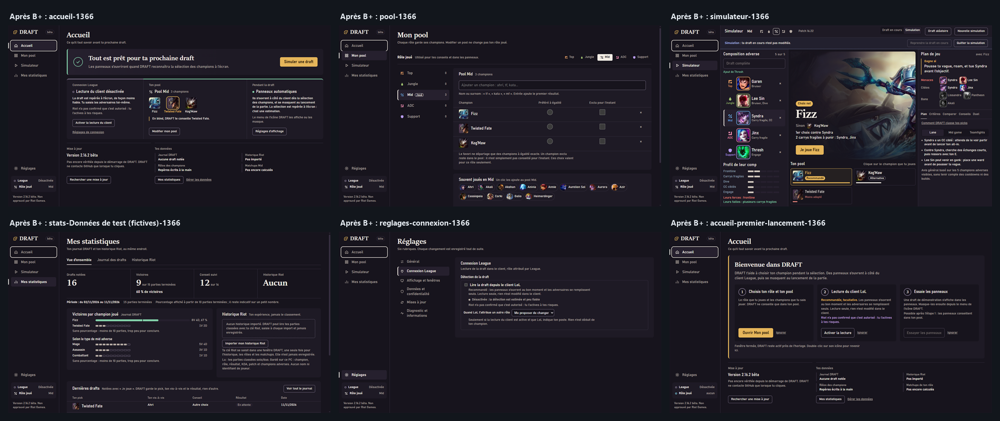

# DRAFT 3.0 · Audit visuel final B+

Branche `da/b-plus` (empilée sur `i18n/1-extraction-fr`, PR #27). Plan : [`PLAN-B-PLUS.md`](PLAN-B-PLUS.md). Brief : [`BRIEF-B-PLUS.pdf`](BRIEF-B-PLUS.pdf).
Cet audit juge le **rendu réel** dans WebView2. Les tests verts ne prouvent pas que l'écran est bon : la liste des défauts restants est en fin de document.

## Méthode des captures

- **Avant** : exe construit depuis la base `5d859a8` (`build.ps1`, dossier temporaire). **Après** : exe construit depuis cette branche.
- Lancement sur un **bureau Windows caché** (aucune fenêtre sur l'écran), page capturée par le protocole de débogage de la WebView2, taille fixée par `Emulation.setDeviceMetricsOverride` avec la session gardée ouverte.
- Tailles : 1366 × 768 et 1920 × 1080 à l'échelle 1. Contrôle à **125 %** (échelle réelle du PC, 120 dpi) : page de 1093 × 614 à l'échelle 1,25, panneaux de 256 × 608 à l'échelle 1,25 (320 px physiques).
- Données **neutres** : copie du profil d'essai (rôle Mid, pool Fizz, Twisted Fate, Kog'Maw), sans `draft-history.js*`, sans journal, sans relevé de validation. Lecture du client désactivée dans cette copie (aucun client League lu).
- Premier lancement : dossier de données vide.
- Simulateur : draft saisie par `draftApi` (Garen, Lee Sin, Syndra, Jinx, Thresh). Panneaux : démonstration de l'application (« Essayer les panneaux » : Sett, Vi, Galio, Samira, Janna).
- Réseau : tout est bloqué sauf `ddragon.leagueoflegends.com` (portraits et illustrations officiels, que l'application utilise normalement). Aucune autre connexion.
- **Données de test** : pour montrer Mes statistiques avec un petit échantillon, un journal **fictif** de 16 drafts (15 terminées, dont 12 sur un même champion) a été écrit dans la copie temporaire, capturé, puis effacé. Les fichiers concernés portent `donnees-de-test` dans leur nom. **Ces chiffres ne sont pas réels.**

## Captures et planches

| Écran | Planches (avant à gauche, après à droite) |
|---|---|
| Accueil configuré | [1366](captures-bplus/planches/accueil-1366.png) · [1920](captures-bplus/planches/accueil-1920.png) · [125 %](captures-bplus/planches/accueil-125pc.png) |
| Accueil, premier lancement | [1366](captures-bplus/planches/accueil-premier-lancement-1366.png) · [1920](captures-bplus/planches/accueil-premier-lancement-1920.png) · [125 %](captures-bplus/planches/accueil-premier-lancement-125pc.png) |
| Mon pool | [1366](captures-bplus/planches/pool-1366.png) · [1920](captures-bplus/planches/pool-1920.png) · [125 %](captures-bplus/planches/pool-125pc.png) |
| Simulateur, draft en cours | [1366](captures-bplus/planches/simulateur-1366.png) · [1920](captures-bplus/planches/simulateur-1920.png) · [125 %](captures-bplus/planches/simulateur-125pc.png) |
| Mes statistiques (état réel : vide) | [1366](captures-bplus/planches/stats-1366.png) · [1920](captures-bplus/planches/stats-1920.png) · [125 %](captures-bplus/planches/stats-125pc.png) |
| Mes statistiques, **données de test fictives** | [1366](captures-bplus/planches/stats-donnees-de-test-1366.png) · [1920](captures-bplus/planches/stats-donnees-de-test-1920.png) |
| Réglages, Général | [1366](captures-bplus/planches/reglages-general-1366.png) · [1920](captures-bplus/planches/reglages-general-1920.png) · [125 %](captures-bplus/planches/reglages-general-125pc.png) |
| Réglages, Connexion League | [1366](captures-bplus/planches/reglages-connexion-1366.png) · [1920](captures-bplus/planches/reglages-connexion-1920.png) · [125 %](captures-bplus/planches/reglages-connexion-125pc.png) |
| Panneaux gauche, droit, compact (340 × 760) | [panneaux](captures-bplus/planches/panneaux.png) |
| Panneaux à 125 % (256 px d'interface) | [panneaux-125pc](captures-bplus/planches/panneaux-125pc.png) |
| Planche globale | [avant](captures-bplus/planches/globale-avant.png) · [après](captures-bplus/planches/globale-apres.png) |

Captures brutes : [`captures-bplus/avant/`](captures-bplus/avant/) et [`captures-bplus/apres/`](captures-bplus/apres/) (30 chacune, mêmes noms).

## Ce qui a changé, écran par écran

### Toute l'application
- Fond graphite à nuance prune (`#17141D`), surfaces `#1E1A25` et `#26202E`. Le turquoise unique a disparu : chaque couleur a un seul sens (tableau du plan, § 2).
- Marque DRAFT et titres de page en Sitka. Le reste en Bahnschrift.
- Navigation active, onglets, sous-navigation, cases cochées : ivoire, plus aucune couleur de sens.
- Boîtes sans contour ; étiquettes en pilule ; rayon des boîtes 8 px.
- Focus : contour ivoire 2 px partout.

### Accueil
- Bannière d'état : titre en Sitka 30 px, filet vert quand tout est prêt, **un seul bouton or** (« Simuler une draft »).
- La chaîne League / pool / panneaux n'est plus trois cartes identiques : un bandeau à trois colonnes séparées par des filets, la colonne du pool plus large.
- Pool montré par les visages (48 px, 64 px sur grand écran), nom dessous. Le champion conseillé en blind porte un cadre or et son nom en or ; la phrase « En blind, DRAFT te conseille… » a un filet or.
- Connexion League en cyan (pointillé en attente), distincte du vert « prêt » et de l'or du conseil.
- Mise à jour et Données : sans boîte, sous un filet.
- Premier lancement : guide encadré d'or (étapes à faire), « Recommandée, facultative » en or, l'avertissement sur l'autorisation de Riot en lavande (sécurité).

### Mon pool
- Rôle joué : pilule ivoire pleine dans la barre, filet ivoire dans la liste des rôles, étiquette « Joué » en contour. Icônes de rôle à leur couleur.
- Tableau : portraits 40 px, noms en condensé 18 px ; ligne **favorite** : cadre or ; ligne **exclue** : portrait gris à 60 % et nom atténué (le mot « Exclu pour l'instant » reste en tête de colonne).
- Suggestions en puces rondes.

### Simulateur
- Grande illustration gardée. Nom du pick en Sitka (42 à 72 px). « Choix net » en pilule or pleine ; « Choix serré » en or pointillé ; bouton « Je joue … » en or.
- Draft adverse : cadre de la couleur du rôle autour de chaque visage, libellé du rôle écrit et coloré ; le Mid probable en cadre pointillé avec la mention en pervenche.
- Classement : tuile conseillée en or (contour, nom, barre, « Recommandé ») ; « Alternative » en contour ; « Moins adapté » en corail.
- Plan de jeu : « Gagne si » sous un filet or ; Menaces en corail ; Bans en gris.
- Mode Simulation : bandeau en pointillé pervenche. **Correction** : le bandeau prenait la ligne flexible de la grille (300 px vides en 1920) ; les lignes adverses ne s'étirent plus à 130 px sur grand écran.

### Panneaux
- Cadre or du conseil (2 px), « Recommandé » en pilule or, « Choix serré » en pointillé, second choix en contour neutre, menace en corail avec le mot « Menace », bouton « Je joue » en or.
- Draft adverse avec cadres de rôle (gauche et compact) ; libellés de rôle gardés.
- Marque en Sitka ; tout le reste en Bahnschrift, mêmes tailles qu'avant (lecture rapide).

### Mes statistiques
- Bandeau de chiffres entre deux filets, chiffres en Sitka 40 px à chiffres alignés.
- **Sous le bandeau, toujours** : la période (« Période : du 02/11/2026 au 11/11/2026 »), le nombre de parties terminées et la règle (« Moins de 10 parties terminées : pas encore de pourcentage… » ou « Pourcentage affiché à partir de 10 parties terminées ; il reste indicatif… »).
- Sous 10 parties : jauge de 10 crans sous « Victoires » ; au-dessus : « 60 % de victoires ».
- Barres par champion et par type de mid : sous 10 parties, **jauge de crans au lieu d'une barre de victoires** ; au-dessus, barre verte avec repère à 50 %.
- Journal vide : les zéros sont atténués et la ligne dit ce qui apparaîtra.

### Réglages
- Inchangés dans leur structure : rubrique active en ivoire, cases ivoire, état de la lecture du client en cyan quand elle est active. Aucun ornement.

## Critères d'acceptation du brief (§ 9)

| Critère | Verdict | Preuve |
|---|---|---|
| DRAFT immédiatement identifiable, pas un dashboard générique | **Atteint en grande partie.** Marque et titres en Sitka, prune, or réservé, cadres de rôle, visages : la planche globale ne ressemble plus au kit turquoise. Les Réglages restent volontairement neutres. | [globale-avant](captures-bplus/planches/globale-avant.png) / [globale-apres](captures-bplus/planches/globale-apres.png) |
| Recommandations et risques distingués par hiérarchie **et** couleur | **Atteint.** Conseil : place (scène, première tuile, bandeau du panneau), taille, étiquette « Recommandé / Choix net / serré » et or. Risque : mot « Menace(s) », filet gauche, corail. Hypothèse : pointillé et pervenche. | [simulateur-1366](captures-bplus/planches/simulateur-1366.png), [panneaux](captures-bplus/planches/panneaux.png) |
| Statistiques : chiffres utiles, période, taille de l'échantillon | **Atteint** pour la vue d'ensemble. Le seuil de 10 parties s'applique au bandeau et aux barres. L'onglet « Historique Riot » garde ses anciens tableaux (pourcentages par groupe, sans période propre). | [stats-donnees-de-test-1366](captures-bplus/planches/stats-donnees-de-test-1366.png) (données fictives) |
| Réglages sobres et rapides ; panneaux compacts et lisibles | **Atteint.** Réglages sans ajout ; panneaux aux mêmes tailles de texte, contrôlés à 340 px et à 256 px (125 %). | [reglages-connexion-1366](captures-bplus/planches/reglages-connexion-1366.png), [panneaux-125pc](captures-bplus/planches/panneaux-125pc.png) |
| Rendu réel validé dans WebView2 aux résolutions ciblées ; aucune fonction disparue | **Atteint.** 60 captures réelles ; bancs de pages, e2e, selftest et migration (ci-dessous). | § Tests |
| Audit final listant les défauts restants | Ce document, § Défauts restants. | — |

## Contrastes mesurés

Calcul WCAG 2.x (luminance relative), sur les valeurs exactes des jetons. Seuils : texte 4,5:1, éléments d'interface 3:1.

| Usage | Avant-plan | Fond | Rapport | Seuil | Verdict |
|---|---|---|---|---|---|
| Texte principal | `#F2ECE4` | `#17141D` | 15,50:1 | 4,5:1 | conforme |
| Texte principal sur surface haute | `#F2ECE4` | `#26202E` | 13,47:1 | 4,5:1 | conforme |
| Texte secondaire | `#B5ABA3` | `#17141D` | 8,07:1 | 4,5:1 | conforme |
| Texte secondaire sur surface | `#B5ABA3` | `#1E1A25` | 7,58:1 | 4,5:1 | conforme |
| Texte secondaire sur surface haute | `#B5ABA3` | `#26202E` | 7,01:1 | 4,5:1 | conforme |
| Or en texte (Choix serré, Gagne si, nom conseillé) | `#E5B55A` | `#1E1A25` | 9,02:1 | 4,5:1 | conforme |
| Or sur surface haute | `#E5B55A` | `#26202E` | 8,35:1 | 4,5:1 | conforme |
| Action principale (encre sur or) | `#241806` | `#E5B55A` | 9,18:1 | 4,5:1 | conforme |
| Vert en texte (victoire, force) | `#82CFA8` | `#1E1A25` | 9,30:1 | 4,5:1 | conforme |
| Encre sur vert (bouton Victoire actif) | `#0B2618` | `#82CFA8` | 8,77:1 | 4,5:1 | conforme |
| Corail en texte (menace, défaite) | `#F1847A` | `#1E1A25` | 6,77:1 | 4,5:1 | conforme |
| Corail sur surface haute | `#F1847A` | `#26202E` | 6,26:1 | 4,5:1 | conforme |
| Encre sur corail (bouton Défaite actif) | `#2B0D0A` | `#F1847A` | 7,15:1 | 4,5:1 | conforme |
| Connexion (texte) | `#79C6DA` | `#1E1A25` | 8,87:1 | 4,5:1 | conforme |
| Sécurité (texte) | `#C9A7E8` | `#1E1A25` | 8,28:1 | 4,5:1 | conforme |
| Hypothèse, incertitude (texte) | `#A3B4EC` | `#1E1A25` | 8,37:1 | 4,5:1 | conforme |
| Rôle Top (libellé, cadre ; cuivre depuis la finition) | `#D0703A` | `#17141D` | 5,25:1 | 4,5:1 | conforme |
| Rôle Top sur surface haute | `#D0703A` | `#26202E` | 4,56:1 | 4,5:1 | conforme |
| Repère des 50 % (finition) | `#F2ECE4` | `#26202E` | 13,47:1 | 3:1 | conforme |
| Rôle Jungle | `#9DBF6E` | `#17141D` | 8,76:1 | 4,5:1 | conforme |
| Rôle Mid | `#6FB0EC` | `#17141D` | 7,88:1 | 4,5:1 | conforme |
| Rôle ADC | `#EC8AAE` | `#17141D` | 7,64:1 | 4,5:1 | conforme |
| Rôle Support | `#B69AEE` | `#17141D` | 7,66:1 | 4,5:1 | conforme |
| Contour de champ, bouton secondaire | `#82778F` | `#17141D` | 4,32:1 | 3:1 | conforme |
| Contour sur surface | `#82778F` | `#1E1A25` | 4,05:1 | 3:1 | conforme |
| Contour sur surface haute (le plus faible) | `#82778F` | `#26202E` | 3,75:1 | 3:1 | conforme |
| Cadre or du conseil | `#E5B55A` | `#17141D` | 9,61:1 | 3:1 | conforme |
| Focus (ivoire) | `#F2ECE4` | `#17141D` | 15,50:1 | 3:1 | conforme |
| Cran de jauge rempli | `#B5ABA3` | `#1E1A25` | 7,58:1 | 3:1 | conforme |
| Cran de jauge vide (contour) | `#82778F` | `#1E1A25` | 4,05:1 | 3:1 | conforme |
| Filet de séparation | `#362F40` | `#17141D` | 1,42:1 | aucun | décoratif |

Non mesurables par calcul : textes posés sur l'illustration du Simulateur et du panneau (voile dégradé). À l'œil, lisibles sur les captures ; c'est le même voile qu'avant, teinté prune.

## Fonctions vérifiées présentes

Aucune commande ni aucun texte n'a été retiré. Changements du DOM : des ajouts (classes `is-fav`, `is-out`, `is-advice`, `home-blind`, `is-empty`, bloc d'échantillon, jauge, enveloppe `kpis-wrap`) et un seul remplacement : sous 10 parties, la barre de victoires d'un groupe devient une jauge de crans (le bilan écrit « 1V 2D » reste à côté). Vérifié par :
- **Captures** : chaque bouton des écrans capturés est présent avant et après (Simuler une draft, Activer la lecture du client, Réglages de connexion, Modifier mon pool, Réglages d'affichage, Rechercher une mise à jour, Mes statistiques, Gérer les données ; rôle joué et rôles, recherche, favori, exclusion, retrait, suggestions, export et import des profils ; Draft en cours / Simulation, Draft aléatoire, Nouvelle simulation, Reprendre, Quitter, Je joue, choix du classement, onglets Plan / Critères / Comparer / Conseils / Duel, Lane / Mid game / Teamfights ; onglets de Mes statistiques, Importer mon historique Riot, Voir tout le journal ; six rubriques des Réglages ; outils des panneaux, Comparer, Détails, Plan de jeu et ban).
- **Bancs de pages** (UX-1, 2, 4, 5, 8, i18n, profils, V2.15) : tous verts, voir ci-dessous.
- **e2e** dans la vraie WebView2 : mêmes résultats que la base (voir ci-dessous).
- **Moteur** : `run-engine-eval -AvecEvaluation`, 0 différence.
- CSP de `web/index.html` identique (la ligne n'est pas dans le diff) ; aucun script en ligne ajouté ; messages natifs, `IsAppPage`, lecture seule LCU non touchés (aucun fichier C# modifié).

## Tests

| Test | Résultat |
|---|---|
| `run-engine-eval -AvecEvaluation` | Banc OK. Développement : 312 comparés, 0 changement ; évaluation gelée : 108 comparés, 0 changement ; INATTENDUS 0. |
| `extract-ui-messages -Scenarios tests/moteur/scenarios-dev.json` | 812 drafts, 3168 étapes ; inventaire 634 entrées ; **0 gabarit hors inventaire** (nouvelle entrée UI-309 pour les textes d'échantillon). |
| `run-role-tests` | 85 réussis, 0 échec. |
| `run-coaching-tests -Work` | Conseils 162/0, égalités 18/0, maîtrise 91/0, moteur stratégique 190/0. |
| `run-v215-tests -Work` | 145 réussis, 0 échec. |
| Pages UX-1 / UX-2 / UX-4 / UX-5 / UX-8 | 28/0, 12/0, 25/0, 19/0, 92/0. |
| Pages i18n / profils | 229/0, 54/0. |
| `run-layout-tests -Work` | 51 passes, TOUT EST BON. |
| `run-layout-tests -Lang qps` | 140 débordements listés, **identiques à la base** (seul écart : un dépassement de la navigation passe de 3 à 2 px) ; 10 textes hors crochets (noms fictifs du banc, comme la base) ; 0 clé absente. |
| `check-catalogs` | 0 erreur (2 alertes déjà présentes dans la base, sur `mastery.*`). |
| `detect-hardcoded -Only web/ -Max 0` | 0 texte en dur. Exclusions : 53 (base : 51) ; les 2 nouvelles sont des noms de classes CSS (`is-empty`, `stats-few`), aucun texte visible. |
| `build.ps1 -Out <tmp>` | OK. |
| `--selftest` (bureau caché) | 284 OK, 0 échec, TOUT EST BON (deux passages). |
| `--e2e` × 2 (bureau caché) | 95 OK, 1 échec à chaque passage : « Raccourci Ctrl+Alt+D enregistré ». **Même résultat sur la base** (exe 5d859a8 : 95 OK, même échec) : le DRAFT ouvert sur ce PC tient déjà le raccourci. |
| `test-migration` (copie de `draft-essai-2162\data`) | Lu : rôle Mid, 3 champions, 96 parties d'historique, profil enregistré ; original non modifié. |

## Défauts : corrigés et restants

Corrigés pendant la finition (voir le tableau ci-dessus) : vide de l'Accueil et de Mon pool en 1920 (réduit, ci-dessous), titres empilés de l'Accueil, répétition bannière / « Pendant la draft », « Leurs failles » (vert confirmé, libellé explicite), Top trop proche de l'or, croix du compact sur le portrait, petits textes des panneaux, repère des 50 % invisible.

Restants (même avec des tests verts) :

1. **1920 × 1080, vide réduit mais pas nul** : l'Accueil occupe 87 % de la hauteur, Mon pool 85 % (mesures des pages de test). Avec un pool de 3 champions, il reste une bande vide sous Mon pool ; aller plus loin demanderait du contenu, ce que le brief refuse.
2. **1366 × 768** : le titre de page étant retiré de l'écran, l'Accueil laisse environ 140 px libres en bas. C'est voulu (rien n'est ajouté), mais la page paraît plus haute qu'elle n'est remplie.
3. **Panneau compact à 125 %** : la croix sous chaque nom ajoute une ligne ; la menace passe sous le pli (il faut défiler pour la voir, elle était à moitié visible avant). « Je joue » et « Détails » restent visibles sans défiler.
4. **Point d'état devant un titre sur deux lignes** (carte League en 1920) : le point est centré sur les deux lignes au lieu d'être aligné sur la première.
5. **Libellés de rôle du compact en 12 px** (semi-gras) : seule exception au minimum de 13 px, faute de largeur (5 colonnes de 45 px à 125 %).
6. **Top cuivre et corail** : ΔE2000 de 16,0, distincts mais du même côté chaud ; jamais au même endroit (cadre de portrait contre texte de menace).
7. **Mode manuel des panneaux** : la bannière et « Pendant la draft » donnent toutes deux le moyen d'afficher les panneaux (raccourci ou menu). Les tests existants exigent cette consigne aux deux endroits ; non changé.
8. **Cases et boutons radio non cochés** : rendu natif sombre de Chromium, contour peu marqué (déjà le cas avant).
9. **Focus au démarrage** : le lien « Accueil » peut avoir le focus visible dès l'ouverture (déjà le cas avant).
10. **Barre de victoires** toujours verte au-dessus du seuil, même sous 50 % ; le repère et le pourcentage écrit corrigent la lecture.
11. **« Aucun »** dans le bandeau des statistiques en Sitka 40 px, comme un chiffre.
12. **Onglet Historique Riot** : anciens tableaux en pourcentages, sans période propre.
13. **Pseudo-langue** : 121 débordements listés pour les futures langues, non traités ici.
14. **Sitka non vérifiée hors de ce PC** (repli Georgia non vu en capture).
15. **Textes sur l'illustration** : contraste non calculable, jugé à l'œil.

## Finition (après validation de B+)

Base : `62f257c` (B+ validée). Branche `da/b-plus`, PR #28. Mêmes méthodes de capture (bureau caché, CDP, réseau limité à `ddragon.leagueoflegends.com`, données neutres, journal **fictif** pour Mes statistiques seulement).
Captures : [`captures-bplus/finition/avant/`](captures-bplus/finition/avant/) (exe de 62f257c) et [`captures-bplus/finition/apres/`](captures-bplus/finition/apres/), 30 chacune. Planches : [`captures-bplus/finition/planches/`](captures-bplus/finition/planches/), dont [globale-avant](captures-bplus/finition/planches/globale-avant.png), [globale-apres](captures-bplus/finition/planches/globale-apres.png), [panneaux](captures-bplus/finition/planches/panneaux.png) et [panneaux-125pc](captures-bplus/finition/planches/panneaux-125pc.png).

### Points traités

| # | Demande | Avant | Après | Preuve |
|---|---|---|---|---|
| 1 | 1920 × 1080 sans contenu artificiel | Accueil : 816 px de contenu pour 1080 (75 %) ; Mon pool : 705 px (65 %). | Accueil : 941 px (87 %) ; Mon pool : 917 px (85 %). Rien n'est ajouté : tailles de lecture, marges, portraits (80 px Accueil, 64 px tableau du pool), suggestions en tuiles. | UX-8 « l'Accueil occupe la hauteur » et UX-4 « Mon pool occupe la hauteur » (échouent sur 62f257c). [accueil-1920](captures-bplus/finition/planches/accueil-1920.png), [pool-1920](captures-bplus/finition/planches/pool-1920.png) |
| 2 | Petits textes des panneaux à 125 % | 296 textes sous 13 px relevés dans les panneaux (traits, notes, « Recommandé », « Alternative », jauges, libellés de rôle à 12 px). | Panneaux : 13 px au minimum (16 px physiques à 125 %), graisse 500 pour les textes secondaires ; libellés de rôle du compact en 12 px semi-gras (exception écrite dans le test). Contraste du texte secondaire : 8,07:1 sur fond, 7,58:1 sur surface, 7,01:1 sur surface haute. | `run-layout-tests`, code PETIT-TEXTE : 296 sur la base, 0 après. |
| 3 | « Je joue » et « Détails » accessibles partout | Déjà conformes : visibles sans défilement, entiers, cibles ≥ 32 px, dans les panneaux droit et compact, aux 8 tailles du banc. | Inchangé, désormais **verrouillé** par un test. Le panneau gauche n'a pas d'actions par conception (il ne montre que la draft adverse ; il est toujours ouvert avec le panneau droit). Sans conseil possible (pool vide, tout exclu), le panneau affiche une consigne sans actions. | `run-layout-tests`, codes ACTION-ABSENTE / PETITE / HORS-ECRAN / TRONQUEE : 0 avant comme après (aucun échec à prouver). |
| 4 | Top distinct de l'or | `#E39B62` : ΔE2000 de 12,7 avec l'or `#E5B55A`. | Cuivre `#D0703A` : ΔE2000 de 23,6 avec l'or, 16,0 avec le corail, 30,3 avec l'ADC, 42,0 avec la Jungle. Contraste 5,25:1 sur le fond, 4,56:1 sur surface haute. Les teintes plus éloignées de l'or sont des magentas criards, écartés. | Calcul ΔE2000 (CIE 2000) sur les jetons. |
| 5 | Croix du panneau compact sur le portrait | La croix chevauchait le portrait à toutes les tailles (116 relevés, jusqu'à 24 × 24 px). | La croix passe sous le nom, centrée, hors du portrait. | `run-layout-tests`, code CROIX-SUR-PORTRAIT (getBoundingClientRect) : 116 sur la base, 0 après. |
| 6 | Repère des 50 % | Le repère était **géométriquement au centre** (mesuré : 569,3 px pour une piste de 370,0 à 768,5). Son défaut : couleur du fond sur la piste, contraste 1,15:1, il ne se voyait que comme une coupure dans la partie remplie. | Trait ivoire de 2 px, au milieu exact (écart 0,0 px), qui dépasse la piste de 3 px en haut et en bas. Contraste 13,47:1 sur la piste. | UX-5 : « au milieu exact » (passait déjà), « sur toute la hauteur » et « visible sur la piste vide » (échouent sur 62f257c). |
| 7 | Répétitions de l'Accueil | Trois titres empilés (« Accueil », phrase, bannière) ; la bannière et « Pendant la draft » disaient la même chose (« la sélection des champions »). | Le titre de page reste pour les lecteurs d'écran (`h1` masqué), la phrase disparaît ; la bannière dit le mode de détection, « Pendant la draft » ne le répète plus. | UX-8 : « pas de titre de page empilé » ×8, « aucune suite de 4 mots répétée » (échouent sur 62f257c). |
| 8 | « Tout est prêt » sans lecture du client | « Les panneaux s'ouvriront quand DRAFT reconnaîtra la sélection… » ; carte League : « …de façon moins fiable ». | Bannière : « Tout est prêt pour ta prochaine draft » + « Détection à l'écran (lecture du client désactivée, facultative). » Carte League : « Facultative. Sans elle, la draft est repérée à l'écran (une estimation) et tu saisis les adversaires toi-même. » Aucun texte n'invite à activer la lecture (le bouton reste une option). | UX-8 : « lecture dite facultative, rien n'invite à l'activer » (échoue sur 62f257c). |
| 9 | « Leurs failles » | Vert, libellé « Leurs failles ». | Le code (`compoReading`) n'y met que des faiblesses adverses : plusieurs carrys fragiles, pas de frontline, peu d'engage, aucun CC ciblé, donc des opportunités pour le joueur. Le vert est gardé, avec un libellé explicite : « Leurs failles, à exploiter ». « Leurs forces » (menaces) reste en corail. | Capture du Simulateur ; catalogue UI-044. |

Autre correction trouvée en route : l'animation des jauges du profil adverse utilisait encore les anciennes couleurs écrites en dur (turquoise `#3fd8c6`). Elle passe en ivoire, et en corail pour une jauge dangereuse.

### Textes modifiés (catalogue `fr.js`)

- Modifiés : `home.hero.ready.connected`, `home.hero.ready.waiting`, `home.hero.ready.off`, `home.league.waiting.text`, `home.league.off.text`, `enemy.effects.weak`.
- Ajouté : `home.hero.ready.unavailable` (« Détection à l'écran. »).
- Retirés (plus affichés) : `home.sub`, `home.panels.detect.lcu`, `home.panels.detect.screen`.
- Catalogue des messages : UI-302, UI-305, UI-306 et UI-044 mis à jour.

### Tests ajoutés (échec prouvé sur 62f257c)

- `run-layout-tests` (`draft-layout-tests.html`, codes ajoutés à la liste bloquante) : PETIT-TEXTE, ACTION-ABSENTE / PETITE / HORS-ECRAN / TRONQUEE, CROIX-SUR-PORTRAIT. Sur une copie de 62f257c avec ces tests : **414 défauts** (296 PETIT-TEXTE, 116 CROIX-SUR-PORTRAIT, 2 ACTION-ABSENTE venus d'une première version du test, depuis restreinte aux panneaux qui ont un conseil). Après : **TOUT EST BON**.
- UX-4 : Mon pool en 1920 (705 px avant, 917 après).
- UX-5 : repère des 50 % (milieu, hauteur, contraste), jauge sous 10 parties, période et pourcentage au-dessus de 10 parties.
- UX-8 : titres empilés, répétition bannière / « Pendant la draft », lecture du client facultative, Accueil en 1920. Sur 62f257c : 16 échecs ; après : 0.
- Assertions UX-8 ajustées à la nouvelle répartition des textes : consigne « Lance League of Legends » dans la bannière seulement, détection dite dans la bannière.

### Tests de la finition

| Test | Résultat |
|---|---|
| `run-engine-eval -AvecEvaluation` | Banc OK ; développement 312 et évaluation gelée 108 comparés, 0 changement, 0 inattendu. |
| `extract-ui-messages` | 812 drafts ; inventaire 634 entrées ; **0 hors inventaire**. |
| `run-role-tests` / `run-coaching-tests` / `run-v215-tests` | 85/0 ; conseils 162/0, égalités 18/0, maîtrise 91/0, moteur 190/0 ; 145/0. |
| Pages UX-1 / UX-2 / UX-4 / UX-5 / UX-8 / i18n / profils | 28/0, 12/0, 27/0, 26/0, 105/0, 229/0, 54/0. |
| `run-layout-tests` | TOUT EST BON (base 62f257c avec les nouveaux contrôles : 414 défauts). |
| `run-layout-tests -Lang qps` | 121 débordements listés (base 62f257c avec les mêmes contrôles : 618) ; aucun nouveau ; 0 clé absente. |
| `check-catalogs` / détecteur | 0 erreur (2 alertes `mastery.*` antérieures) / 0 texte en dur. |
| `--selftest` (bureau caché) | 284 OK, 0 échec, TOUT EST BON. |
| `--e2e` × 2 (bureau caché) | 93 OK, 1 échec à chaque passage (« Raccourci Ctrl+Alt+D enregistré ») ; **identique à la base 62f257c** (93 OK, même échec), dû à l'instance DRAFT de l'utilisateur qui tient le raccourci. |
| `test-migration` (copie de `draft-essai-2162\data`) | Rôle Mid, 3 champions, 96 parties d'historique, profils enregistrés ; original non modifié. |
