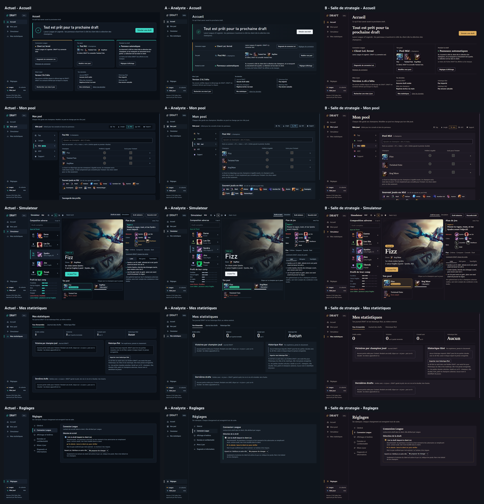

# Comparatif et recommandation

Étude courte pour choisir une direction graphique. Ce n'est pas une refonte de production.
Lire d'abord le [DIAGNOSTIC](DIAGNOSTIC.md), puis [DIRECTION-A](DIRECTION-A.md) et [DIRECTION-B](DIRECTION-B.md).

## Les planches

Même écran, même taille, de gauche à droite : actuel, A, B.

| Écran | 1366 × 768 | 1920 × 1080 |
|---|---|---|
| Accueil (configuré) | [accueil-1366](captures/planches/accueil-1366.png) | [accueil-1920](captures/planches/accueil-1920.png) |
| Mon pool | [pool-1366](captures/planches/pool-1366.png) | [pool-1920](captures/planches/pool-1920.png) |
| Simulateur, draft en cours | [simulateur-1366](captures/planches/simulateur-1366.png) | [simulateur-1920](captures/planches/simulateur-1920.png) |
| Mes statistiques (état réel : vide) | [stats-1366](captures/planches/stats-1366.png) | [stats-1920](captures/planches/stats-1920.png) |
| Réglages, Connexion League | [reglages-1366](captures/planches/reglages-1366.png) | [reglages-1920](captures/planches/reglages-1920.png) |
| Overlay : panneau gauche, droit, compact (340 × 760) | [panneaux](captures/planches/panneaux.png) | |
| Planche globale (cinq écrans, 1366) | [globale](captures/planches/globale.png) | |
| Statistiques avec données (**maquette, données d'illustration**) | [maquette-statistiques](captures/planches/maquette-statistiques.png) | |

## Tableau de comparaison

| Critère | Actuel | A « Analyste » | B « Salle de stratégie » |
|---|---|---|---|
| Identité | Kit générique : fond presque noir, un turquoise pour tout. | Instrument d'analyse : ardoise, bouton ivoire, chiffres Bahnschrift condensés. Sobre, reconnaissable par sa rigueur. | Éditorial et chaleureux : encre prune, Sitka, laiton, cadres de rôle. Reconnaissable au premier regard. |
| Lisibilité pendant une draft (30 s) | Bonne, mais le turquoise ne hiérarchise pas. | **La meilleure** : chaque couleur a un sens, l'action est la seule forme claire, les menaces ressortent seules. | Très bonne pour reconnaître les champions (visages plus grands, cadres de rôle) ; le serif se lit moins vite en petit. |
| Hiérarchie | Plate, tout pèse pareil. | Nette : pick en 46 à 72 px, chiffres héros, liste d'état à colonnes fixes. | Très nette mais plus « magazine » : grands titres, peu de cadres. |
| Densité | Cartes étirées et vides en 1920. | Dense et régulière ; lignes à hauteur fixe. Vides restants en 1920 sur Mon pool. | Plus aérée ; portraits plus grands qui remplissent mieux le 1920, plus serrée en 1366. |
| Couleur utile | 1 accent, 2 sens. | 5 sens + 5 rôles, tous distincts par la saturation et le signe. | 4 sens + laiton du conseil + 5 rôles vifs ; jungle et victoire proches. |
| Portraits | 24 à 28 px, liseré Riot visible. | 28 à 48 px, recadrés, pied de rôle. Sobres. | 32 à 60 px, recadrés, cadre de rôle. Forts. |
| Statistiques | Chiffres 24 px, règle des 10 parties seulement dans les barres. | Chiffres héros 42 px, jauge de 10 crans sous le seuil. | Chiffres en Sitka 44 px (alignés), même règle du seuil. |
| Overlay | Lisible. | Lisible, contraste du bouton maximal (16:1). | Lisible ; compact à reprendre (noms tronqués, libellés serrés). |
| Accessibilité (WCAG) | Conforme. | Conforme : texte ≥ 6,5:1, contours ≥ 3,99:1. Sens jamais porté par la couleur seule. | Conforme : texte ≥ 7:1, contours ≥ 3,81:1. Chiffres elzéviriens à neutraliser. |
| Effort (PR) | — | **2 à 3 jours** : jetons, ≈ 250 lignes CSS, 4 petits changements HTML. | **4 à 5 jours** : idem + typographie Sitka, hauteurs 1366, overlay compact, image de chargement. |
| Risques | Image « générée par IA ». | Peut paraître froide ; la discipline des couleurs doit tenir dans le temps. | Peut paraître « magazine » ; laiton proche de l'or du client Riot ; serif moins lisible en petit. |

## Recommandation

**Choisir A « Analyste », en lui empruntant deux idées de B.**

Pourquoi A :
1. Le brief dit « premium, sobre, orienté performance et stratégie ». A est la réponse la plus directe : la couleur devient de l'information, pas de la décoration.
2. Pendant une draft, on a 30 secondes. A met la menace, le conseil et l'action à trois places et trois traitements différents ; rien d'autre ne crie.
3. A garde Bahnschrift, la seule personnalité actuelle, et la pousse (chiffres héros, condensé gras). Le changement reste dans la famille de l'application : pas de rupture pour les utilisateurs actuels.
4. Effort moitié moindre, risques plus faibles (overlay déjà propre, pas de nouvelle police à régler).

À prendre dans B :
- **Les cadres de rôle autour des portraits de la draft adverse** (plus forts que le pied de 3 px de A), en gardant les couleurs de rôle douces de A.
- **Le pool montré par les visages sur l'Accueil** (56 px, nom dessous), et le portrait du conseil en blind dans le bandeau du haut.

À laisser dans B : la serif Sitka et le fond prune. Ils donnent du caractère, mais tirent l'outil vers le magazine.

## Suite proposée

1. Valider la direction (A + emprunts, ou B, ou A pure).
2. PR « DA-1 : jetons et couleurs de sens » : remplace les variables, retire les contours inutiles. Tests de contraste mis à jour.
3. PR « DA-2 : portraits et chiffres » : échelle de portraits, cadres de rôle, règle des 10 parties dans le bandeau des statistiques.
4. PR « DA-3 : Accueil et grands écrans » : conseil en blind avec portrait, liste d'état, occupation du 1920.

## Méthode

- Application construite depuis cette branche avec `build.ps1`, dans un dossier temporaire.
- Pour A et B : copie temporaire de `web/`, ajout de `direction.css` et d'une seule balise `<link>` après la feuille principale. Le dépôt n'est pas modifié ; les feuilles d'étude sont ici, dans `docs/direction/`.
- Lancement sur un **bureau Windows caché** (aucune fenêtre visible), données neuves : profil seulement (rôle Mid, pool Fizz, Twisted Fate, Kog'Maw), sans historique, sans journal, sans relevé de validation.
- Captures par le protocole de débogage de la WebView2, taille de page fixée à 1366 × 768 et 1920 × 1080 (échelle 1), session CDP gardée ouverte pour que la taille tienne.
- Draft du Simulateur saisie par `draftApi` : Garen (Top), Lee Sin (Jungle), Syndra (Mid), Jinx (ADC), Thresh (Support).
- Overlay : ouvert par la commande « Essayer les panneaux » de l'application, qui joue sa propre draft de démonstration (Sett, Vi, Galio, Samira, Janna).
- Réseau : tout est bloqué sauf `ddragon.leagueoflegends.com` (portraits et illustrations officiels, comme dans l'application). Aucune autre connexion.
- Mes statistiques : état réel, vide. Les chiffres de la maquette sont **inventés** et marqués comme tels.

## Limites

- Étude par feuille ajoutée : certaines règles sont des surcharges (`!important` hérités des tailles de portrait). Une vraie PR réécrit les règles au lieu de les empiler.
- Pas de structure HTML changée : les vides du 1920 (Mon pool, sous le profil adverse) restent visibles dans les captures ; les changements nécessaires sont décrits dans chaque direction.
- Les panneaux sont capturés à 340 × 760 et à l'échelle 1 ; l'échelle Windows 125 % (256 px utiles) n'a pas été recapturée.
- Écrans non couverts : premier lancement guidé, erreurs de connexion, mode Simulation (seul le bandeau hachuré est stylé), onglets Critères, Comparer, Conseils, Duel.
- Sitka et Bahnschrift vérifiées sur Windows 10 ; Segoe UI Variable (Windows 11) n'a pas pu être vue, le repli Segoe UI est ce qui apparaît dans les captures.

## Contrastes mesurés

Calcul WCAG 2.x (luminance relative), sur les couleurs exactes des feuilles d'étude. Seuils : texte 4,5:1, éléments d'interface 3:1.

#### Direction A « Analyste »

| Usage | Avant-plan | Fond | Rapport | Seuil | Verdict |
|---|---|---|---|---|---|
| Texte principal | `#e8eef4` | `#0f151c` | 15,70:1 | 4,5:1 | conforme |
| Texte principal sur surface | `#e8eef4` | `#1c2631` | 13,11:1 | 4,5:1 | conforme |
| Texte secondaire | `#9dabbb` | `#0f151c` | 7,84:1 | 4,5:1 | conforme |
| Texte secondaire sur surface haute | `#9dabbb` | `#1c2631` | 6,55:1 | 4,5:1 | conforme |
| Action principale (encre sur ivoire) | `#0f151c` | `#eef2f6` | 16,31:1 | 4,5:1 | conforme |
| Avantage / victoire (texte) | `#3fd0a0` | `#151d26` | 8,69:1 | 4,5:1 | conforme |
| Étiquette « Recommandé » (encre sur menthe) | `#05261b` | `#3fd0a0` | 8,27:1 | 4,5:1 | conforme |
| Menace / défaite (texte) | `#ff7b74` | `#151d26` | 6,75:1 | 4,5:1 | conforme |
| Risque / choix serré (texte) | `#f0b24a` | `#151d26` | 9,04:1 | 4,5:1 | conforme |
| Hypothèse (texte) | `#97b6ff` | `#151d26` | 8,46:1 | 4,5:1 | conforme |
| Simulation (texte) | `#c9a3ff` | `#151d26` | 8,23:1 | 4,5:1 | conforme |
| Rôle Top (icône et libellé) | `#cfa77c` | `#0f151c` | 8,28:1 | 4,5:1 | conforme |
| Rôle Jungle | `#9cc07a` | `#0f151c` | 8,94:1 | 4,5:1 | conforme |
| Rôle Mid | `#82bfdc` | `#0f151c` | 9,12:1 | 4,5:1 | conforme |
| Rôle ADC | `#dc98b8` | `#0f151c` | 8,06:1 | 4,5:1 | conforme |
| Rôle Support | `#b1aae4` | `#0f151c` | 8,51:1 | 4,5:1 | conforme |
| Bordure de champ et bouton secondaire | `#6b7c94` | `#0f151c` | 4,31:1 | 3:1 | conforme |
| Bordure de champ sur surface | `#6b7c94` | `#151d26` | 3,99:1 | 3:1 | conforme |
| Filet de séparation (décoratif, non requis) | `#26323f` | `#0f151c` | 1,41:1 | aucun | décoratif |

#### Direction B « Salle de stratégie »

| Usage | Avant-plan | Fond | Rapport | Seuil | Verdict |
|---|---|---|---|---|---|
| Texte principal | `#f3ede5` | `#16131b` | 15,80:1 | 4,5:1 | conforme |
| Texte principal sur surface haute | `#f3ede5` | `#29242f` | 13,01:1 | 4,5:1 | conforme |
| Texte secondaire | `#b9afa6` | `#16131b` | 8,53:1 | 4,5:1 | conforme |
| Texte secondaire sur surface haute | `#b9afa6` | `#29242f` | 7,02:1 | 4,5:1 | conforme |
| Action principale (encre sur laiton) | `#21170a` | `#dcab5c` | 8,41:1 | 4,5:1 | conforme |
| Laiton en texte (conseil serré, onglet) | `#dcab5c` | `#1e1a24` | 8,16:1 | 4,5:1 | conforme |
| Avantage / victoire (texte) | `#80d59c` | `#1e1a24` | 9,70:1 | 4,5:1 | conforme |
| Menace / défaite (texte) | `#ff8f7b` | `#1e1a24` | 7,71:1 | 4,5:1 | conforme |
| Hypothèse (texte) | `#a3b8ec` | `#1e1a24` | 8,65:1 | 4,5:1 | conforme |
| Simulation (texte) | `#6ccbd8` | `#1e1a24` | 9,09:1 | 4,5:1 | conforme |
| Rôle Top (cadre et libellé) | `#e49b5d` | `#16131b` | 8,00:1 | 4,5:1 | conforme |
| Rôle Jungle | `#7cc47c` | `#16131b` | 8,79:1 | 4,5:1 | conforme |
| Rôle Mid | `#66b0f2` | `#16131b` | 7,92:1 | 4,5:1 | conforme |
| Rôle ADC | `#f07ea3` | `#16131b` | 7,19:1 | 4,5:1 | conforme |
| Rôle Support | `#b897f3` | `#16131b` | 7,66:1 | 4,5:1 | conforme |
| Bordure de champ et bouton secondaire | `#7d7290` | `#16131b` | 4,10:1 | 3:1 | conforme |
| Bordure de champ sur surface | `#7d7290` | `#1e1a24` | 3,81:1 | 3:1 | conforme |
| Filet de séparation (décoratif, non requis) | `#383142` | `#16131b` | 1,48:1 | aucun | décoratif |

#### État actuel (pour comparaison)

| Usage | Avant-plan | Fond | Rapport | Seuil | Verdict |
|---|---|---|---|---|---|
| Texte principal | `#e8eef5` | `#0a0f16` | 16,45:1 | 4,5:1 | conforme |
| Texte secondaire | `#93a3b6` | `#111822` | 6,93:1 | 4,5:1 | conforme |
| Accent turquoise (texte) | `#3fd8c6` | `#111822` | 10,06:1 | 4,5:1 | conforme |
| Action (encre sur turquoise) | `#04211e` | `#3fd8c6` | 9,54:1 | 4,5:1 | conforme |
| Or (texte) | `#d4b36a` | `#111822` | 8,88:1 | 4,5:1 | conforme |
| Menace (texte) | `#f2777a` | `#111822` | 6,53:1 | 4,5:1 | conforme |
| Bordure de champ | `#6b7c94` | `#0a0f16` | 4,52:1 | 3:1 | conforme |
